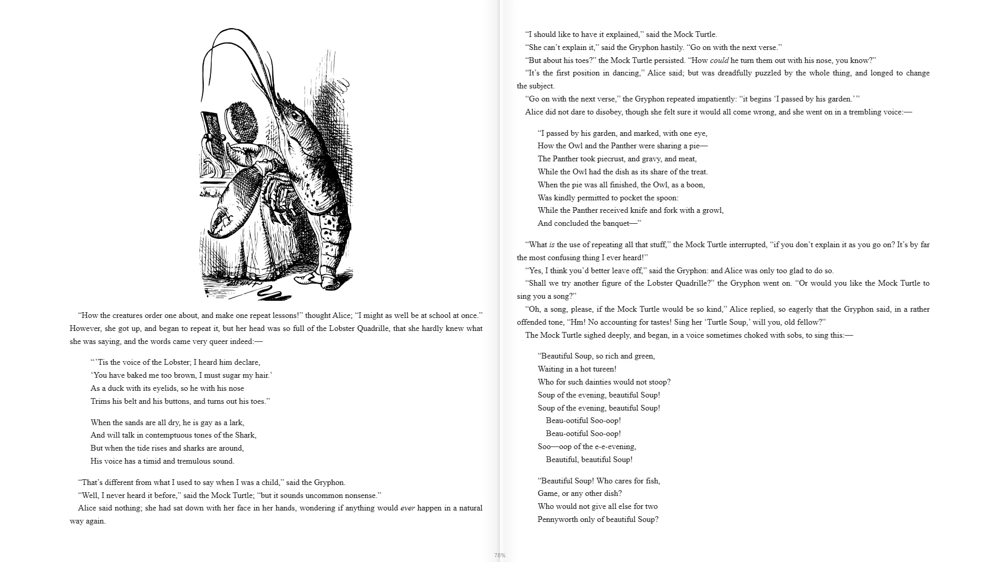

# WittyEbook

An ebook reader for EPUB 2 and 3, made for long and careful reading. You need it to read EPUB books in WittyMediaServer.

<!-- pictures -->



<sub>Text and cover from [Standard Ebooks](https://standardebooks.org/), [CC0](https://creativecommons.org/publicdomain/zero/1.0/).</sub>


<sub>A shelf of books in WittyMediaServer, from [Standard Ebooks](https://standardebooks.org/), [CC0](https://creativecommons.org/publicdomain/zero/1.0/).</sub>

<!-- /pictures -->

## What it does

- **Book view:** two pages side by side, one page or scrolling. *Auto* picks for the screen.
- **Exact resume:** the place is a spot in the text, so a book reopens on the same words at any size, on any device.
- **Time left** in the chapter and the book, from your own reading speed.
- **Your typography:** font, 60 to 250 percent size, line spacing, margins, and justification with hyphenation.
- **Comfortable at night:** light, sepia, dark and black pages, brightness, and a warm night light.
- **Footnotes in a pop-up,** so you can read a note without leaving the page.
- **Study tools from WittyInk:** highlights and notes tied to the words, search, a pen with pressure, and reading aloud.
- **Safe with any book:** chapters show in a sandbox where no script can run, and links never navigate the page away.

The Reader page, and how the server takes a book apart, stay with the server. No books come with it.

How to use it is in **Help** inside WittyMediaServer: see Books, PDFs and comics.

## How to get it

An admin adds it from the module store inside WittyMediaServer: **Settings → Modules**, then **Browse the store**, then **Add** beside WittyEbook. That needs WittyMediaServer 0.6.0-alpha or later, and it works with nothing older. The range this version fits is in `module.json`: 0.6.0-alpha through 0.6.x.

Adding it brings WittyInk, which it's built on.

## What it needs

[WittyInk](https://github.com/wittywilla/WittyInk), and React 18 or newer, which the app provides.

## Platforms

It's one browser bundle for every system the server runs on, and it runs on whichever device opens the server. It has been seen working in a desktop browser, against a test server on Linux. It also runs in the WittyReader app. Safari, real phones and real TVs have not been tried.

## Building and testing

You need Node.js 22, as CI uses, and Go for the manifest check. In a worktree, first run the copy of `dev-modules.mjs` kept above the repositories (`node D:/projects/dev-modules.mjs` on the development machine). It writes only links that git ignores, so the checkout builds against the repositories beside it.

```bash
npm install
```

```bash
npm run build:bundle
```

That makes one script and one stylesheet, as a server installs them. To check the manifest:

```bash
go run github.com/wittywilla/wittymodule/cmd/wittymodule check .
```

It has no tests of its own yet. CI checks the manifest and builds the bundle.

To use it in another app, give it a `ReaderHost` whose `epub` field supplies the book: see [Embedding](wiki/Embedding.md). The other guides in [wiki/](wiki/Home.md) cover [reading and layout](wiki/Reading-and-layout.md), [text and display](wiki/Text-and-display.md), [study tools](wiki/Study-tools.md) and [every key](wiki/Keyboard-shortcuts.md).

## Licence

Apache-2.0: see [LICENSE](LICENSE) and [NOTICE](NOTICE). If you redistribute it or build on it, keep the NOTICE attribution.

## Legal

WittyEbook is an independent open-source project. It isn't associated with, sponsored by or endorsed
by any publisher, rights holder, service or other media software project. No books come with it, and
it doesn't check the ones you open: you're responsible for having the rights to them. Any
third-party names here only describe what it works with, and belong to their owners. It's provided
“as is”, with no warranty; see [LICENSE](LICENSE). Local law applies to how you use it. This isn't
legal advice.

<!-- module-kit -->
## Releasing

A version tag builds the bundle for the browser, signs the checksum list, and publishes a release that servers can install.

Versions move in small steps as work lands. `go run github.com/wittywilla/wittymodule/cmd/wittymodule@v0.3.0 bump .` raises it
everywhere it is written (add `-part minor` for a bigger step). A bump isn't a release: nothing is
tagged or published until you tag it. CI fails when code changed since the last tag and the version
didn't, because tags never move.

To release:

1. Check that `version` in `module.json` is the one to publish, with the bump committed.
2. Tag that commit and push the tag: `git tag vX.Y.Z`, then `git push origin vX.Y.Z`. A tag with a
   suffix, such as `v1.2.0-beta`, is published as a prerelease.
3. Watch the *Actions* tab. The signing step uses the `WMS_SIGNING_KEY` secret of the `release` environment, and nothing is published without it.

To take a version back, run the *withdraw* workflow from the *Actions* tab. It adds the version to a signed list on the release tagged `withdrawals`, which servers read.

Licensed under Apache-2.0: see [LICENSE](LICENSE) and [NOTICE](NOTICE).
<!-- /module-kit -->
